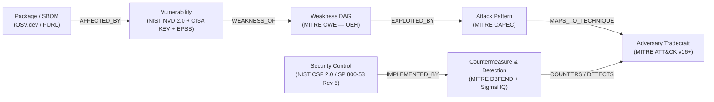

# cybersec-kg — Unified Open Cybersecurity Knowledge Graph

**`cybersec-kg`** unifies nine authoritative, openly redistributable security registries into a single multi-layer property, hierarchy (OEH), vector (HNSW), and optimization-ready knowledge graph (`.sgsnap`) for [Samyama Graph](https://github.com/samyama-ai/samyama-graph).

---

## Why `cybersec-kg` Exists

Security practitioners face disconnected data silos that describe a single causal chain in reality:

Joining open-source transitive dependencies (`Cargo.lock`, `uv.lock`, `package-lock.json`, SPDX/CycloneDX SBOMs) through live exploitability (`CISA KEV` + `FIRST EPSS`), weakness hierarchies (`CWE`), attack patterns (`CAPEC` $\rightarrow$ `ATT&CK`), defensive countermeasures (`D3FEND` + `Sigma`), and regulatory controls (`NIST SP 800-53 Rev 5` / `CSF 2.0`) allows one graph to answer:

1. **Supply-Chain Blast Radius:** Which transitive dependencies expose weaponized (`in_cisa_kev = true` or `epss_score >= 0.5`) vulnerabilities reachable from production services?
2. **Hierarchy-Accelerated Threat Roll-Ups:** Subtree aggregation over `CWE` (`ChildOf` DAG), `D3FEND` (`DigitalArtifact` / `DefensiveTechnique`), and `NIST 800-53` control families via Samyama's Order-Embedding Hierarchy (OEH) index.
3. **Hybrid Semantic + Structural Threat Hunting:** HNSW vector similarity over CVE advisories, threat reports, and Sigma rules filtered by OEH branch and graph reachability.
4. **Pareto-Optimal Remediation Cuts (`CALL algo.or.solve`):** Minimum-disruption patch and control selection severing crown-jewel attack paths under engineering sprint budgets on the included synthetic `OpenSecOps-Twin` topology (or your own imported SBOM/asset overlay).

---

## Data Layers & License Summary

Every upstream source is audited for open redistribution in [PROVENANCE.md](PROVENANCE.md) (no copyrighted ISO 27001 or CIS Benchmark prose is included):

| Layer | Authoritative Source | Data License | Primary Node Labels |
|---|---|---|---|
| **1. Supply Chain** | [OSV.dev](https://osv.dev) (`PyPI`, `crates.io`, `npm`, `Maven`, `Go`, `Debian/Ubuntu`) | `CC-BY-4.0` | `Ecosystem`, `Package`, `PackageRelease`, `Advisory` |
| **2. Vulnerabilities & Exploitability** | [NIST NVD 2.0](https://nvd.nist.gov/), [CISA KEV](https://www.cisa.gov/known-exploited-vulnerabilities-catalog), [FIRST EPSS](https://www.first.org/epss/) | Public Domain / `CC0-1.0` / Open Attribution | `CVE`, `CPE`, `Product`, `Vendor` |
| **3. Weakness & Attack Bridge** | [MITRE CWE](https://cwe.mitre.org/), [MITRE CAPEC](https://capec.mitre.org/) | MITRE Royalty-Free License | `CWE` *(OEH)*, `CAPEC` |
| **4. Adversary Tradecraft** | [MITRE ATT&CK](https://attack.mitre.org/) (Enterprise, Cloud, Mobile, ICS) | MITRE Royalty-Free License | `Tactic`, `Technique`, `SubTechnique`, `ThreatGroup`, `Software`, `Campaign`, `DataSource`, `DataComponent` |
| **5. Defense, Detection & Controls** | [MITRE D3FEND](https://d3fend.mitre.org/), [SigmaHQ](https://github.com/SigmaHQ/sigma), [NIST OSCAL](https://github.com/usnistgov/oscal-content) (SP 800-53 Rev 5 & CSF 2.0) | MITRE RF / `Apache-2.0` / Public Domain | `DefensiveTechnique` *(OEH)*, `DigitalArtifact` *(OEH)*, `DetectionRule`, `SecurityControl` |
| **6. Reference Enterprise Twin** | `OpenSecOps-Twin` (deterministic synthetic Cloud/K8s/OT benchmark topology) | `Apache-2.0` | `Asset`, `SecurityZone`, `NetworkFlow`, `SBOMComponent`, `RemediationAction` |

> **Scholarly Companion Graph:** `cybersec-kg` contains **100% deterministic registry & synthetic-twin records** (zero LLM-synthesized edges). For academic security papers, methods, datasets, and open problems extracted from OpenAlex (`IEEE S&P`, `USENIX Security`, `ACM CCS`, `NDSS`, `RAID`), federate with the companion **`cybersec-research-kg`** snapshot via shared `CVE`, `CWE`, `CAPEC`, and `Technique` identifiers.

---

## Attribution Notice

© 2026 The MITRE Corporation. Portions of this knowledge graph (ATT&CK®, CWE™, CAPEC™, D3FEND™) are reproduced and distributed with the permission of The MITRE Corporation. See [PROVENANCE.md](PROVENANCE.md) for complete source citations and license terms.
